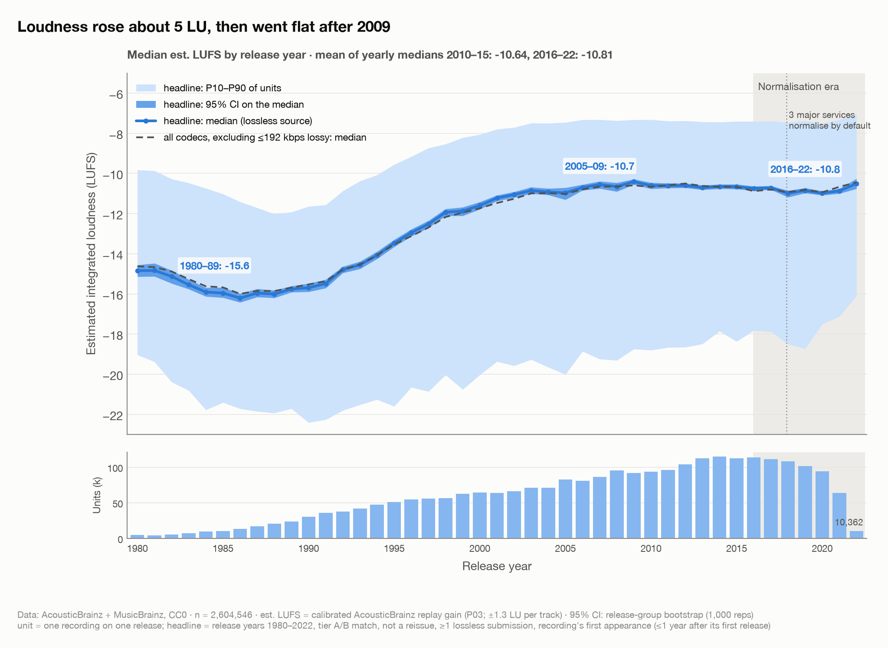

# Turned Down for What

**Is the loudness war over?** Loudness and dynamic range of 2.6 million tracks released 1980–2022, measured from AcousticBrainz and linked to MusicBrainz release dates, before and after streaming services began normalising playback loudness.

- **Read the article:** https://johnpospisil.github.io/loudness-war/
- **Look up an album:** https://johnpospisil.github.io/loudness-war/app/ (181,582 albums)



## Findings

**No: the loudness war ended in a stalemate around 2008, before streaming normalisation.** The full claims, with strength tags, are in [`notes/p20_findings.md`](notes/p20_findings.md).

- **Loudness rose about 5 LU and then stopped.** The median new release went from −16.2 est. LUFS (1986) to −10.4 (2009). Every year since has stayed between −11.0 and −10.4. *Strong.*
- **The rise ended around 2007–09, years before normalisation became the default** (YouTube December 2015, Spotify and Tidal 2017).
  - A search over every candidate year puts the turning point at 2007 (plausible range 2006–09).
  - Each of the 12 genres bends at about the same time.

  *Strong.*
- **There is no break at 2015–16.**
  - Against the straight 2000–2014 trend that the project set out to test, 2016–22 sits 0.6 LU below. That is because the line keeps rising after the real series had levelled off.
  - With the 2007 bend modelled, a 2015/16 break adds −0.08 LU [−0.23, +0.07].
  - Across 114 specifications (samples, weightings, genre mixes, submission cohorts), the answer depends on the model form, not the data choice.
  - The design could detect a step of about 0.2 LU.

  *Moderate.*
- **The loudest records never came down.** The 90th percentile has sat at about −7.4 est. LUFS every year since 2003. *Strong.*
- **Dynamics didn't come back.** Estimated loudness range has been flat since 2005. What changed after 2009 is timbre: at the same loudness and genre, spectra are flatter and darker. *Moderate.*
- **Remasters are louder than the originals:** a median of +1.1 LU per track, and +2.6 LU for albums first issued on CD in the 1980s. The gap has eased a little since the late 2000s. *Moderate.*
- **The measure holds up.**
  - On 149 tracks from 13 CDs measured directly to EBU R128, the estimate's bias is −0.04 LU, with a typical error of 1.15 LU per track.
  - Album rankings agree with the Dynamic Range Database (ρ = −0.90, aggregates only).
  - Low-bitrate MP3 reads 0.26–0.42 LU quiet, so the headline uses lossless copies.

**No causal claim.** The timing argues against normalisation being what ended the loudness war, but it can't say what did.

## How it works

1. **Ingest.** Stream all 30 AcousticBrainz low-level dump parts (632 GB) without storing them, keeping about 55 fields per submission (29.5 M submissions). Read the MusicBrainz full export with DuckDB.
2. **Match.** Match every submission to its exact MusicBrainz release, and flag reissues, compilations and editions.
3. **Deduplicate.** Take the median per (recording, release), using lossless copies first, and exclude gain-altered and stream-ripped files.
4. **Calibrate.** AcousticBrainz has no EBU R128 field. Its replay gain and dynamic complexity are calibrated against pyloudnorm on the same audio to give **estimated LUFS** and **estimated LRA**.
5. **Model.**
   - interrupted time series with break-year scans and placebos;
   - quantile regression;
   - a partially pooled Bayesian genre model (PyMC);
   - remaster pairs;
   - spectral descriptors;
   - a 114-estimate robustness curve.
6. **Validate.** Check against the author's own CD rips, controlled lossy re-encodes and the Dynamic Range Database.
7. **Publish.** A Quarto article whose numbers are all read from the model outputs, and a static album lookup that runs DuckDB-WASM in the browser.

Each step has a write-up in [`notes/`](notes/) (`p01` … `p24`). Data sources, licences, field definitions and exclusions are in [`DATA.md`](DATA.md).

## Reproduce

You need macOS or Linux, [uv](https://docs.astral.sh/uv/), [Quarto](https://quarto.org) ≥ 1.4 (for the article), and Node with Playwright (only for the browser test). Disk: about 50 GB for parsed data and caches. The raw dumps are streamed, never stored whole.

```bash
make setup     # Python 3.12 venv with all dependencies (uv sync)
make help      # every target, in pipeline order

make ingest    # P05–P07: stream and parse the AcousticBrainz + MusicBrainz dumps (~2 days, network-bound, resumable)
make rebuild   # P08–P22: matching → analysis table → models → figures → article → app → docs/ site, then lint + tests (~45 min)
make all       # ingest + rebuild
```

- **Repeatable:** every step is a `make` target and safe to re-run. Random seeds are fixed, and `make check` (ruff + pytest) pins the row counts and headline numbers: 29,460,584 submissions, 2,604,546 headline units, and the yearly medians.
- **Needs the author's audio:** `make calibrate` (P03) and `make validate` (P18) read the author's own music. Their outputs are committed (`data/reference/proxy_calibration.json`) or pinned in tests.
- **The site:** `docs/` is the GitHub Pages site (article, app, interactive charts), built by `make site`.

### Browser test for the app

```bash
python3 -m http.server 8765 -d docs &
node <playwright-skill-dir>/run.js app/tests/smoke.js    # SITE_URL=… to test the live site, HEADLESS=1
```

## Repository

```
src/lw/           ingest/, build/ (parse, match, dedupe, genres), measure/ (R128, own rips),
                  models/ (yearly, its, quantile_trends, genre_hier, remaster_pairs, descriptors,
                  validation, robustness), viz/ (one module per prompt + final), report/, app/
data/reference/   normalisation timeline, proxy calibration, genre map (committed)
notes/            one write-up per step; p20_findings.md has the graded claims
figures/          every figure (PNG, 200 dpi; HTML for interactive ones); final_* are the article's
report/           index.qmd → index.html (the article)
app/              the album lookup (index.html, app.js, data/)
docs/             the published site
tests/            pytest suite (parser fixtures, matching cases, pinned results)
```

## Data and credits

- **Data:** [AcousticBrainz](https://acousticbrainz.org) and [MusicBrainz](https://musicbrainz.org), both CC0.
- **Normalisation timeline:** cited sources in `data/reference/normalisation_timeline.csv`.
- **Dynamic Range Database** ([dr.loudness-war.info](https://dr.loudness-war.info)): used for an aggregate comparison only.

By John Pospisil.

## Licence

- **Code** (`src/`, `tests/`, `app/*.js`, `scripts/`, `Makefile`): [MIT](LICENSE).
- **Article, figures and notes** (`report/`, `figures/`, `notes/`, `docs/`): [CC BY 4.0](LICENSE-CONTENT.md). Credit "John Pospisil, *Is the Loudness War Over?*" with a link.
- **Data**: AcousticBrainz and MusicBrainz are CC0; the derived album table in `app/data/` is also released as CC0. Dynamic Range Database values are not redistributed (aggregates only), see [`DATA.md`](DATA.md).
