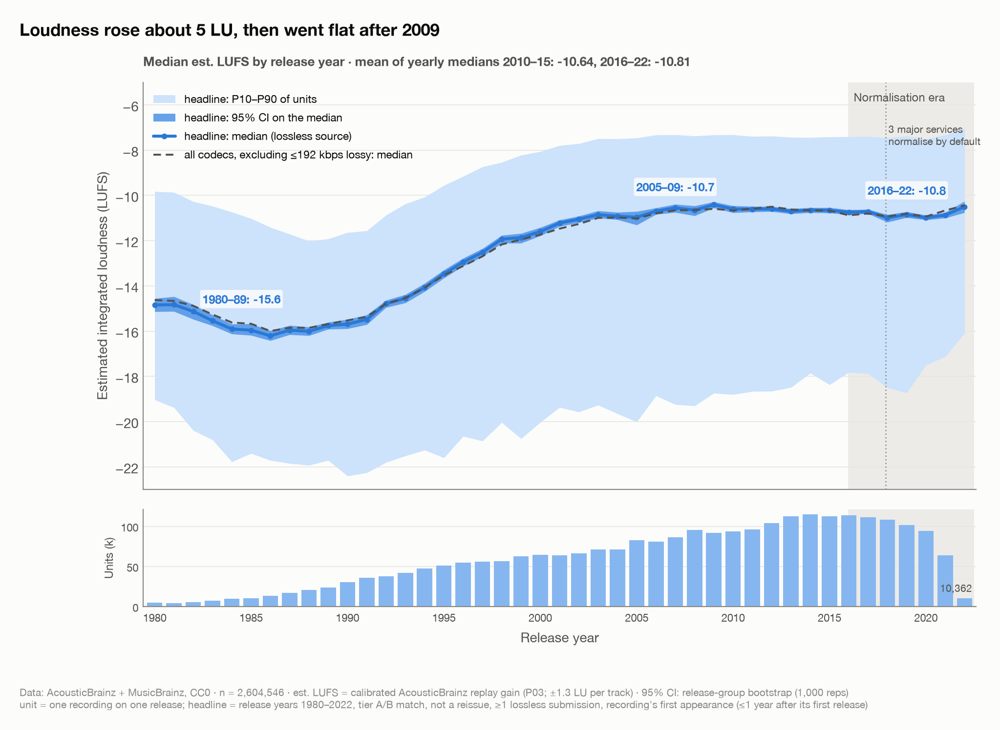
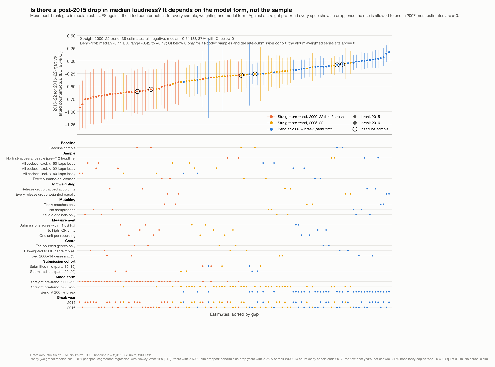
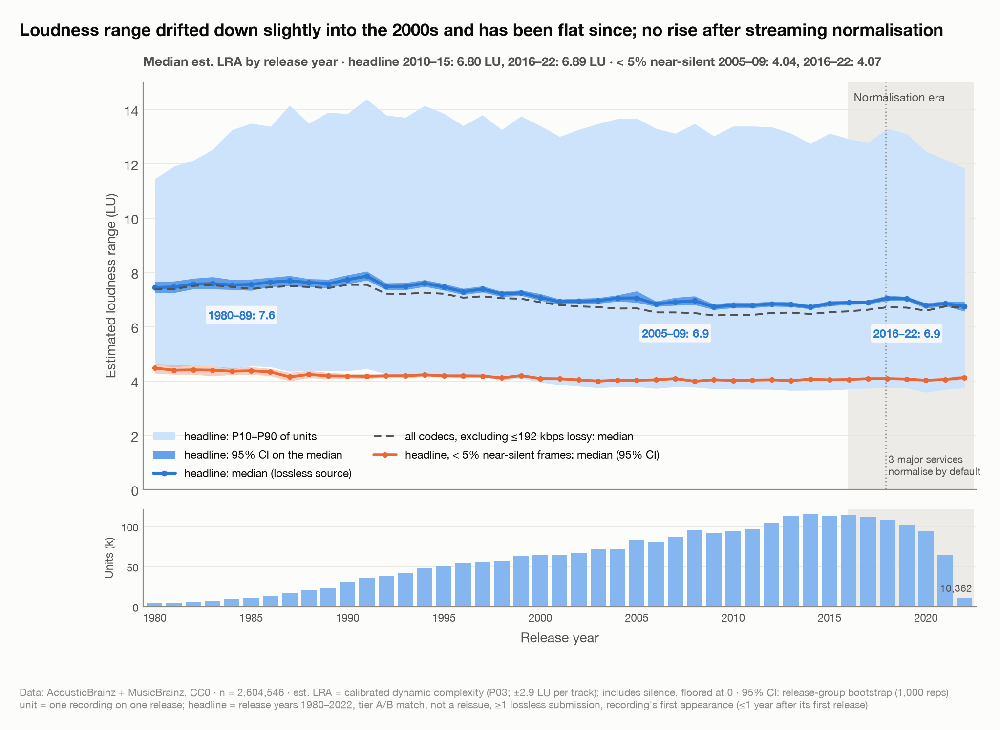
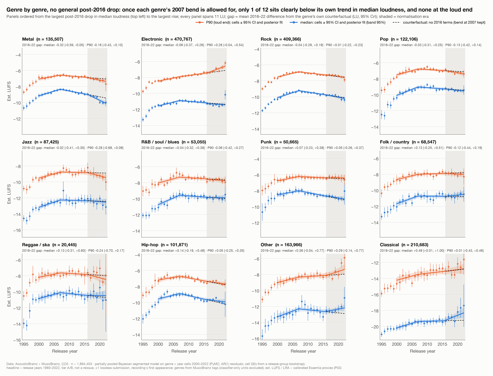
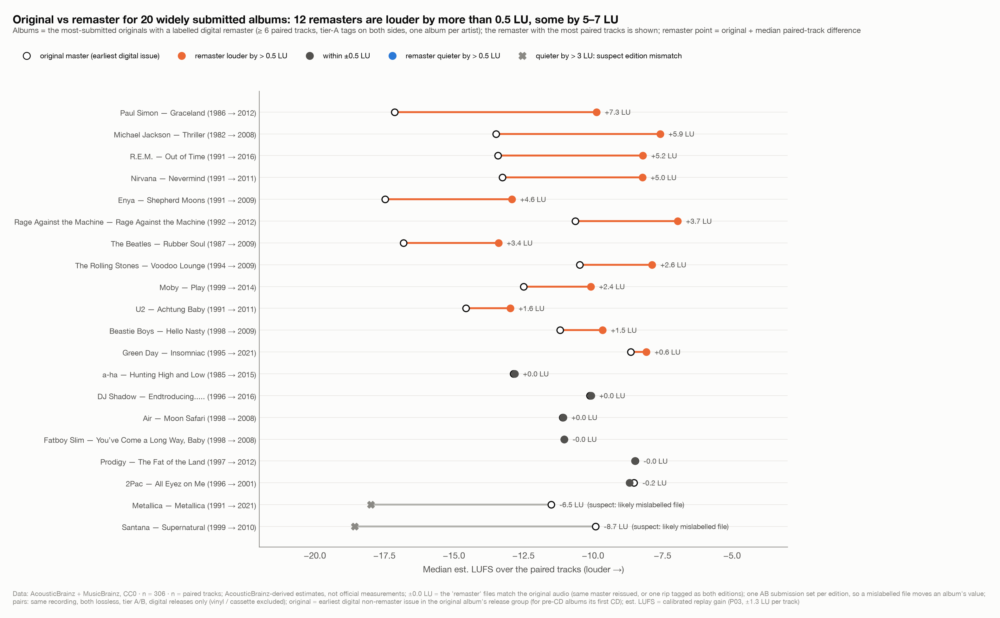
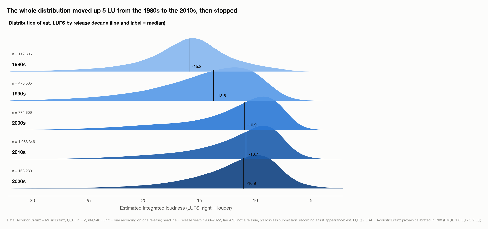
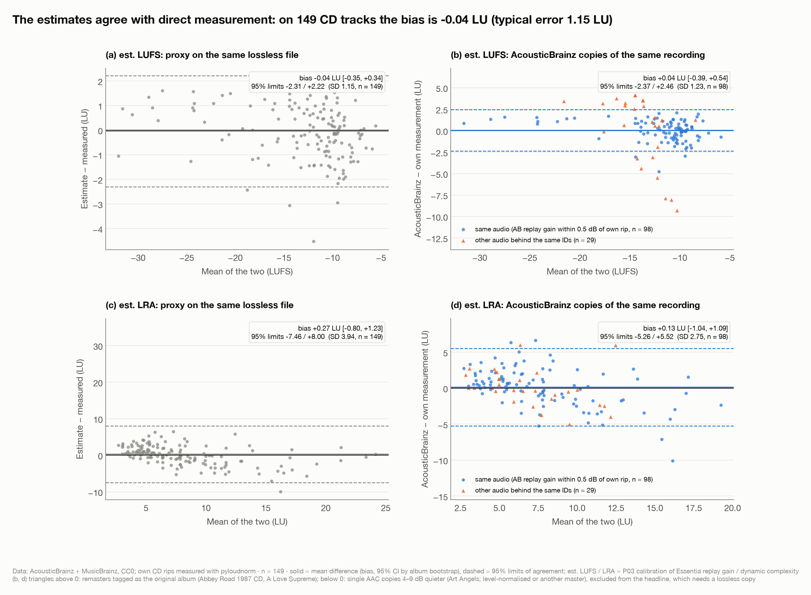
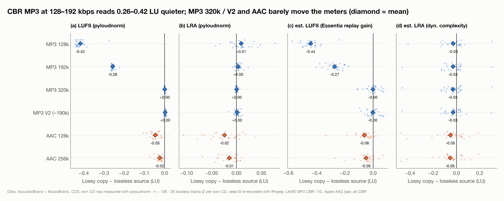

```{python}
#| label: setup
import json
from pathlib import Path

import polars as pl

ROOT = Path.cwd().parent if Path.cwd().name == "report" else Path.cwd()
n = json.loads((ROOT / "data/processed/article_numbers.json").read_text())
tl = pl.read_csv(ROOT / "data/reference/normalisation_timeline.csv")
H, R, V, G, Q, I = n["hero"], n["robustness"], n["validation"], n["genre"], n["quantile"], n["its"]
MONTHS = ["January", "February", "March", "April", "May", "June", "July", "August",
          "September", "October", "November", "December"]


def x(v, d=1, sign=False):
    """Number with a typographic minus."""
    s = f"{v:+.{d}f}" if sign else f"{v:.{d}f}"
    return s.replace("-", "−")


def ci(lo, hi, d=2):
    return f"[{x(lo, d, True)}, {x(hi, d, True)}]"


def k(v):
    return f"{v:,.0f}"


def mil(v):
    return f"{v / 1e6:.1f} million"


def when(id_):
    d = tl.filter(pl.col("id") == id_)["event_date"][0]
    parts = str(d).split("-")
    return f"{MONTHS[int(parts[1]) - 1]} {parts[0]}" if len(parts) > 1 else parts[0]


def lufs(id_):
    return x(tl.filter(pl.col("id") == id_)["target_LUFS"][0], 0)
```

::: {.callout-tip appearance="simple"}
## The short answer

**No — the loudness war ended in a stalemate around 2008, before streaming normalisation.** Across `{python} mil(n["data"]["units_headline"])` tracks, the median new release got about `{python} x(H["m2005_09"] - H["m1980s"], 0)` LU louder between the 1980s and the late 2000s, peaked in `{python} H["peak_year"]`, and has been flat ever since. Nothing changed at 2015–16, when the big streaming services started turning loud masters down by default.
:::

{fig-alt="Line chart of median estimated loudness by release year, 1980 to 2022. It falls slightly to about −16 LUFS in the mid-1980s, rises steeply through the 1990s to about −10.5 LUFS by 2007–09, and stays flat after that, including through the shaded normalisation era from late 2015."}

*Median estimated integrated loudness of new releases by release year, with the 10th–90th percentile band of tracks and the normalisation era shaded. [Interactive version](../figures/final_hero_lufs.html).*

**How loud is your favourite album?** [Look it up](../app/index.html) among `{python} k(n["data"]["n_albums_app"])` albums and see where it sits against records from the same years.

## The question

For two decades, records got louder. Engineers pushed limiters harder because a louder master sounded "better" in a quick comparison on the radio, in a shop or in a playlist. The cost was dynamic range: the difference between the quiet and loud parts of a song was squashed so the whole thing could sit near full scale.

Streaming was supposed to end this. When a service normalises playback, it measures each track's loudness and turns the loud ones down to a common target, so a heavily limited master no longer plays louder; it only sounds flatter. YouTube began normalising music in `{python} when("youtube_2015")`. Spotify moved its reference to `{python} lufs("spotify_minus14_2017")` LUFS in `{python} when("spotify_minus14_2017")`, Tidal switched normalisation on by default in `{python} when("tidal_2017")`, and Amazon, Deezer and Apple followed by `{python} when("apple_lufs_2022")`. The Audio Engineering Society published its streaming loudness recommendation in `{python} when("aes_td1004")`. If incentives drive mastering, new releases should have got quieter and more dynamic after about 2015–17.

**The test we set ourselves before looking:** the claim that normalisation ended the loudness war would be wrong if loudness and loudness range show no break after 2015, compared with their 2000–2014 trend, in most genres.

## The data

[AcousticBrainz](https://acousticbrainz.org) collected `{python} mil(n["data"]["submissions"])` audio analyses from volunteers' music libraries before it closed in 2022, each with the file's [MusicBrainz](https://musicbrainz.org) IDs. We matched every submission to its exact release and release date, took the median per recording and release, and kept original releases from 1980–2022 that have at least one lossless copy, counting each recording only on its first appearance (no reissues, no box sets of old recordings). That leaves **`{python} mil(n["data"]["units_headline"])` tracks**.

AcousticBrainz did not store the broadcast-standard loudness measures (EBU R128) directly, so we **calibrated** the replay-gain value it did store against real measurements of the same audio. The result, *estimated LUFS*, is accurate to about ±`{python} x(V["proxy"]["lufs"]["rmse"], 1)` LU per track and unbiased on CD audio (see [Can we trust the numbers?](#trust)); averaged over tens of thousands of tracks a year, that error disappears. Everything below is in estimated LUFS (integrated loudness) and estimated LRA (loudness range), and the full method is in the appendix.

## Loudness rose about 5 LU, then stopped

The median new release went from `{python} x(H["low"])` LUFS in `{python} H["low_year"]` to `{python} x(H["peak"])` in `{python} H["peak_year"]`, and since then every year has sat between `{python} x(H["range_2009_22"][0])` and `{python} x(H["range_2009_22"][1])`. The 2016–22 average (`{python} x(H["m2016_22"], 2)`) is within a couple of tenths of the 2005–15 average (`{python} x(H["m2005_15"], 2)`): a touch lower if every track counts once, unchanged (`{python} x(H["album_2005_15"], 2)` vs `{python} x(H["album_2016_22"], 2)`) if every album counts once. Either way, **flat**.

The shape is visible without any model. Loudness stopped rising around 2007–09 and simply stayed there; the normalisation era (shaded) arrives years into the plateau.

**The loudest records never came down.** The loudest 10% of each year's tracks sat at `{python} x(H["p90_2005_15"], 2)` LUFS on average in 2005–15 and `{python} x(H["p90_2016_22"], 2)` in 2016–22. If anything, the loud end stopped rising first: its turning point is `{python} Q["hinge_p95"]`–`{python} Q["hinge_p90"]`, against `{python} Q["hinge_p50"]` for the median.

## Was there a break in 2015?

The test we set asks whether 2016–22 sits below the 2000–2014 trend. Taken literally, it does: a straight line through 2000–2015 projects loudness still rising, and 2016–22 falls `{python} x(-I["straight_2016"]["gap"], 2)` LU short of it. Most genres "pass" the same test.

But that straight line is the wrong yardstick, because the rise had already ended. Any series that climbs and then levels off will fall below a straight line fitted through the climb. Three things show it:

- **Where does the data put the break?** Searching every candidate year, the best-fitting turning point is `{python} I["scan_hinge"]["best_break"]` (plausible range `{python} I["scan_hinge"]["set95"][0]`–`{python} I["scan_hinge"]["set95"][-1]`). Neither 2015 nor 2016 is in the range.
- **Allow the bend, then test 2015.** With a turning point in 2007, adding a 2015 or 2016 break changes the fit by `{python} x(R["headline_bend"]["gap"], 2, True)` LU (95% CI `{python} ci(R["headline_bend"]["lo"], R["headline_bend"]["hi"])`). Moving the turning point anywhere from 2006 to 2011 doesn't change the answer.
- **The bend wins out of sample in every genre.** A Bayesian model fitted to each of the 12 genres separately prefers the bend over the straight trend by a wide margin (by `{python} x(G["loo"]["lufs_median"]["diff"], 0)` ± `{python} x(G["loo"]["lufs_median"]["se"], 0)` points of expected log predictive density).

{fig-alt="Specification curve of 114 estimates of the post-2015 change in median loudness. Estimates against a straight pre-trend are all negative, around −0.3 to −0.9 LU; estimates against the bend-first model cluster around zero, from about −0.4 to +0.2 LU. An indicator grid below shows which sample, weighting, genre and cohort choices each estimate uses."}

*Every way we could think of to cut the data. Each dot is one estimate of the post-2015 change, sorted; the grid below shows the choices behind it.*

To check that this isn't one convenient choice, we re-ran the test `{python} R["n_estimates"]` ways: lossless only, the most reliable release matches only, no compilations, genre-reweighted to all of MusicBrainz, a fixed genre mix, album-weighted, by when the files were submitted, and more. **What decides the answer is the model form, not the data choice.** Against a straight trend, all `{python} R["straight"]["n_estimates"]` estimates show a drop (median `{python} x(R["straight"]["gap_median"], 2)` LU). With the bend, the lossless samples all fall between `{python} x(R["lossless_variants_bend_range"][0], 2, True)` and `{python} x(R["lossless_variants_bend_range"][1], 2, True)` LU.

**So: no break.** More precisely, no step larger than about `{python} x(R["mde"], 1)` LU, which is the smallest change this design could reliably detect. Our own falsification test, correctly specified, does not support the hypothesis.

## Dynamics didn't come back either

{fig-alt="Line chart of median estimated loudness range by release year. It drifts down from about 7.5 LU in the 1980s to about 6.9 LU by the mid-2000s and stays flat after that. A second line for tracks with little silence is flat at about 4 LU throughout the 2000s and 2010s."}

If normalisation removed the reason to squash dynamics, loudness range (LRA) should have risen. It didn't. Median estimated LRA drifted from `{python} x(n["lra"]["m1980s"])` LU in the 1980s to `{python} x(n["lra"]["m2005_09"])` in 2005–09 and was `{python} x(n["lra"]["m2016_22"])` in 2016–22. Estimated LRA is sensitive to silence (intros, fades, gaps), so the second line keeps only tracks with almost none: it is flat, `{python} x(n["lra"]["ls_2005_09"], 2)` → `{python} x(n["lra"]["ls_2016_22"], 2)` LU.

What *did* change after 2009 is timbre. At the same loudness and genre, 2016–22 music has the same dynamics as 2009–15 music but flatter, darker spectra: spectral flatness up `{python} x(n["descriptors"]["flatness_sd_2016"], 2)` standard deviations and the spectral centroid down `{python} x(-n["descriptors"]["centroid_2016"], 0)` Hz. Music got denser in sound, not in level. (One descriptor, a modest effect; we don't know why.)

## Genre by genre

{fig-alt="Twelve small line charts, one per genre, of median and 90th-percentile estimated loudness from 2000 to 2022, with model fits. Every genre rises until about 2007 and is flat or slightly falling after, with no visible step at 2016."}

Every genre tells the same story. Before 2007 every genre's median rose `{python} x(G["b1_range"][0], 2)`–`{python} x(G["b1_range"][1], 2)` LU a year; after 2007 the slopes are `{python} x(G["b2_range"][0], 2)` to `{python} x(G["b2_range"][1], 2, True)`, flat or gently falling. Once each genre's own bend is allowed for, the average post-2016 change across genres is `{python} x(G["median_bend"]["pooled_gap"][0], 2, True)` LU `{python} ci(G["median_bend"]["pooled_gap"][1], G["median_bend"]["pooled_gap"][2])`, and `{python} G["n_within_02"]` of 12 genres are within ±0.2 LU.

The exceptions are small and few, about as many as chance would give across 12 genres. **Metal** is the one genre that looks quieter after 2016 (`{python} x(G["metal"]["gap"], 2, True)` LU). **Electronic**'s loud end is the only one still rising (`{python} x(G["electronic_p90"]["b2"], 2, True)` LU a year since 2007). **Classical** looks louder, but that turns out to be which labels' releases people submitted, plus less silence in the tracks: holding label and silence fixed, its change is `{python} x(G["classical_controls"]["label_fe_silence"]["est"], 2, True)` LU `{python} ci(G["classical_controls"]["label_fe_silence"]["lo"], G["classical_controls"]["label_fe_silence"]["hi"])`.

## Remasters are louder than the originals

{fig-alt="Dumbbell chart of 20 widely submitted albums, each showing the original master's estimated loudness and its remaster's. Most remasters sit to the right, louder, some by 5 to 7 LU; a few are unchanged."}

The same recording, original master against its labelled remaster, across `{python} k(n["remaster"]["counts"]["track_pairs"])` track pairs from `{python} k(n["remaster"]["counts"]["orig_albums"])` albums: the remaster is a median `{python} x(n["remaster"]["counts"]["median_d_lufs"])` LU louder, and `{python} x(n["remaster"]["album_median_by_decade"]["1980s"])` LU louder (album median) for albums whose first CD came out in the 1980s. Among the famous albums above, `{python} n["remaster"]["n_famous_louder"]` of `{python} n["remaster"]["n_famous"]` remasters are louder by more than half an LU. The remaster gap has eased a little: 2015–22 remasters are `{python} x(-n["remaster"]["post2015_vs_2005_14"]["est"], 1)` LU less over-loud than 2005–14 ones, but like everything else it turned in the late 2000s, with no step at 2016.

## The shape of the distribution

{fig-alt="Ridgeline plot of estimated loudness distributions by decade. Each decade's distribution shifts to the right, louder, from the 1980s to the 2000s; the 2010s and 2020s sit where the 2000s were."}

Each decade's distribution moved right until the 2000s, and the 2010s and 2020s sit on top of it. The quiet tail kept rising a little (the 10th percentile went `{python} x(H["p10_2005_09"])` → `{python} x(H["p10_2016_22"])`), but most of that is the genre mix: fewer quiet classical releases in later years.

## Can we trust the numbers? {#trust}

{fig-alt="Four Bland–Altman panels comparing estimated and directly measured loudness and loudness range for 149 CD tracks. Loudness differences scatter tightly around zero; loudness range differences are wider."}

We ripped `{python} V["own"]["n_albums"]` CDs (`{python} V["own"]["n_tracks"]` tracks, bit-verified) and measured them directly to the broadcast standard. The calibrated estimate is off by `{python} x(V["proxy"]["lufs"]["bias"], 2, True)` LU on average, with a typical error of `{python} x(V["proxy"]["lufs"]["rmse"], 2)` LU per track. Where AcousticBrainz holds the same audio, its stored values reproduce our own run of the same software exactly. Against the community-run [Dynamic Range Database](https://dr.loudness-war.info), the `{python} V["dr"]["n_albums"]` matched albums we measure as louder have lower DR scores, almost in lockstep (rank correlation `{python} x(V["dr"]["rho"]["r"], 2)`, `{python} x(V["dr"]["within"]["r"], 2)` within a release year; aggregate comparison only).

{fig-alt="Dot plot of how much each lossy encoding changes measured loudness. MP3 at 128 kbps reads about 0.4 LU quieter and 192 kbps about 0.26 LU quieter; 320 kbps MP3, V2 MP3 and AAC change it by less than 0.05 LU."}

One trap we found along the way: **low-bitrate MP3 reads quieter.** Re-encoding the same CD tracks, a 128 kbps MP3 measures `{python} x(V["enc"]["mp3_128"], 2)` LU and a 192 kbps MP3 `{python} x(V["enc"]["mp3_192"], 2)` LU below the original; 320 kbps MP3 and AAC barely move. In AcousticBrainz, recent releases are far more often represented by low-bitrate files: `{python} x(100 * n["lossy_low160_share"]["2015_22"], 0)`% of lossy-only tracks from 2015–22 releases are ≤160 kbps, against `{python} x(100 * n["lossy_low160_share"]["2000_09"], 0)`% for 2000–09 releases. On its own, that would fake a post-streaming "drop". That is why every result here is built on lossless copies.

## What this doesn't show

- **Cause.** The timing argues against normalisation being what *ended* the loudness war, since the rise stopped years earlier. But timing can't tell us what did: mastering tools, taste, engineers' advocacy and the decline of CD-era competition all changed in the same years.
- **All music.** AcousticBrainz is a volunteer collection, heavier on rock and classical and on people who own lossless files. Reweighting to the genre mix of all MusicBrainz releases shifts the level by `{python} x(R["mb_mix_shift"], 1, True)` LU but not the shape.
- **After 2022.** AcousticBrainz closed in 2022, and its last year is thin (`{python} k(n["data"]["n_2022"])` tracks). A slow decline that started after 2020 would not show yet.
- **Peaks.** AcousticBrainz kept no sample or true peak, so we can't measure crest factor (peak-to-loudness), the most direct sign of limiting.

## Appendix: methods

::: {.callout-note collapse="true"}
## Data and matching (click to expand)

- **Sources:** AcousticBrainz low-level and high-level dumps (all 30 parts, `{python} mil(n["data"]["submissions"])` submissions, streamed and parsed without storing the archives) and the MusicBrainz full export; both CC0.
- **Release matching:** tier A = the file's release ID tag names a release containing the recording; tier B = date and album tags match one of its releases; tier C (fallback to the earliest release) is excluded from the headline. Reissues are flagged by release date (more than a year after the release group's first release), keyword (remaster, anniversary, reissue, legacy, expanded) and format.
- **Units:** one recording on one release, `{python} mil(n["data"]["units"])` in all; loudness is the median over its lossless submissions (lossy if none). Exclusions: duration < 30 s, implausible loudness, MP3Gain-tagged and stream-rip files.
- **Headline sample:** release years 1980–2022, tier A/B, not a reissue, at least one lossless submission, and the recording's first appearance (release year ≤ its earliest MusicBrainz release + 1): `{python} k(n["data"]["units_headline"])` units.
- **Genres:** MusicBrainz release-group tags mapped to 12 genres, falling back to release, recording and artist tags, then the AcousticBrainz classifier (flagged).
:::

::: {.callout-note collapse="true"}
## Measurement and calibration

- AcousticBrainz stores Essentia's `replay_gain` and `dynamic_complexity`, not EBU R128. We ran the same Essentia extractor and pyloudnorm (ITU-R BS.1770 / EBU Tech 3342, verified against the EBU test signals) on the same audio and fitted est. LUFS = `{python} x(n["calibration"]["lufs_rg"]["const"], 2)` − `{python} x(abs(n["calibration"]["lufs_rg"]["slope"]), 3)` × replay gain (CV RMSE `{python} x(n["calibration"]["lufs_rg"]["cv_rmse"], 2)` LU) and est. LRA = `{python} x(n["calibration"]["lra_dc"]["const"], 2)` + `{python} x(n["calibration"]["lra_dc"]["slope"], 2)` × dynamic complexity (CV RMSE `{python} x(n["calibration"]["lra_dc"]["cv_rmse"], 2)` LU). The loudness slope's uncertainty (±`{python} x(100 * n["calibration"]["lufs_rg"]["slope_se"] / abs(n["calibration"]["lufs_rg"]["slope"]), 1)`%) scales every LU difference by at most that much.
- **Validation** on `{python} V["own"]["n_tracks"]` lossless CD tracks not used in the fit: bias `{python} x(V["proxy"]["lufs"]["bias"], 2, True)` LU `{python} ci(*V["proxy"]["lufs"]["bias_ci"])`, RMSE `{python} x(V["proxy"]["lufs"]["rmse"], 2)`. Estimated LRA compresses the wide-dynamic end (our classical discs read several LU low), so LRA trends are reported as directions only.
- **Uncertainty on yearly medians:** release-group cluster bootstrap (1,000 replicates); median 95% CI half-width `{python} x(n["data"]["ci_halfwidth_median"], 2)` LU.
:::

::: {.callout-note collapse="true"}
## Models

- **Interrupted time series** on the yearly median, 2000–2022: level and slope change at 2015 or 2016 against (a) a straight pre-trend (the pre-registered test) and (b) a continuous bend at 2007 plus the 2015/16 terms. Newey-West standard errors; break-year sensitivity 2013–2017; placebo breaks 1995–2010; a likelihood-profile break search. Placebos show the p-values on this bending series are anti-conservative, so we rely on effect sizes and consistency rather than significance.
- **Quantile regression** (τ = 0.05–0.95) with the same forms, cluster bootstrap and HAC intervals.
- **Genres:** a partially pooled Bayesian model (PyMC) on genre × year cells with AR(1) residuals; `{python} n["genre_diag"]["n_fits"]` fits, `{python} n["genre_diag"]["divergences"]` divergences, R-hat ≤ `{python} x(n["genre_diag"]["max_rhat"], 2)`; PSIS-LOO compares the forms.
- **Remasters:** same recording, original digital master vs labelled remaster (both lossless, digital-only), mixed model with an album random effect.
- **Robustness:** `{python} R["n_estimates"]` estimates across sample, weighting, matching, measurement, genre and submission-cohort choices; minimum detectable step ≈ `{python} x(R["mde"], 2)` LU (80% power).
- **Claims and their strength** are graded in the project's QA notes (`notes/p20_findings.md`). Code, tests and a one-command rebuild (`make all`) are in the repository.
:::

*Data: AcousticBrainz and MusicBrainz (CC0). Dynamic Range Database (dr.loudness-war.info, accessed 2026-11-14) used for aggregate comparison only. No causal claim is made.*
